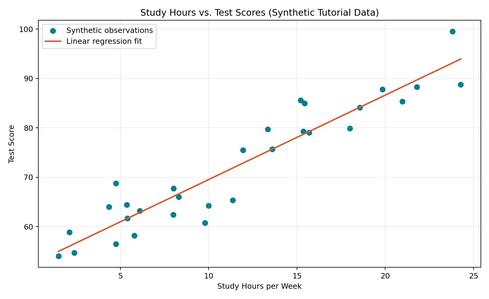

# Python Pickling Practice

**Student: LanMingqi (26723811)**

This repository implements all four parts of the course exercise
`session-3/practice-pickling-of-a-model.md`.
It includes executable code **and the generated serialized files**, as requested.

## Run

Use Python 3.11 or 3.12 with the pinned dependencies:

```bash
python -m pip install -r requirements.txt
python run_practice.py
python load_saved.py
python load_saved.py --hours 12.5 7.8 22
```

`run_practice.py` generates and checks all artifacts. `load_saved.py` is a separate
program that loads the existing files and makes predictions **without retraining**.
The grade-tracker class is defined in `grade_tracker.py` so its pickle is importable
in a fresh Python process. Keep that module alongside the other files.

## Exercise coverage and submitted files

| Part | Work performed | Generated files |
|---|---|---|
| 1 | Save/reload a list, a dictionary, and a nested structure; assert equality | `fruits.pkl`, `scores.pkl`, `complex_data.pkl` |
| 2 | Save/reload a custom GradeTracker; add three students; save updated object | `ml_course_grades.pkl`, `ml_course_grades_updated.pkl` |
| 3 | Train the tutorial's synthetic linear regression; save/reload; predict new scores | `study_hours_model.pkl`, `study_hours_model.png` |
| 4 | Save/reload the same model with joblib; verify identical predictions | `study_hours_model.joblib` |

Additional evidence:

- `execution_log.txt`: actual output of the full exercise.
- `reload_log.txt`: actual output from the independent loading program.
- `results.json`: structured grades, coefficients, metrics, predictions, and package versions.
- `artifact_manifest.json`: file sizes and SHA-256 checksums for generated binary artifacts.

The code keeps the tutorial's random seed (42), synthetic-data recipe, and example
student grades. Grade timestamps change on reruns. All names and scores in the demo
are fictional tutorial data. This is a persistence exercise, not a real student-assessment tool.

## Recorded local execution

| Check | Actual result |
|---|---|
| Initial class average | 87.000 |
| Updated class average | 86.875 |
| Regression coefficient | 1.709775 |
| Regression intercept | 52.435081 |
| Training MSE | 16.791596 |
| Training R-squared | 0.885466 |
| pickle / joblib predictions identical | True |
| Fresh-process reload | Passed |

## Model and evaluation

The model learns a linear relationship between study hours and scores from 30
synthetic observations: a base score of 50, approximately 2 additional points per
study hour, and Gaussian noise. The MSE and R-squared reported in the log are
**training-set metrics**, matching the tutorial; they are not held-out test results.
The prediction function rejects negative or non-finite hours. Scores are not clipped
to 0--100 because this is an unconstrained regression demonstration.



## What pickle does

- `pickle.dump(object, file)` serializes an object into a binary file opened with `wb`.
- `pickle.load(file)` restores it from a file opened with `rb`.
- A restored trained model can call `predict` immediately; it does not need another `fit`.
- joblib is an alternative persistence tool used here on the same model.

Only unpickle files from a trusted source. Pickle and joblib loading can execute
code; checksums in the same repository detect accidental corruption, not malicious
replacement. Matching the recorded Python/package versions is recommended.

## Submit

Create a **new GitHub repository**, such as `python-pickling-practice`, and upload
all files in this folder, including the `.pkl` and `.joblib` files, graph, and logs.
Do not upload only a ZIP file. Send that repository's URL **and your name** to the
course WeChat group. See `UPLOAD_CN.md` for the browser-only steps.

Code and documentation were prepared with AI assistance and executed locally.
